<div align="center">

# 🔍 Kali Linux + Zenmap: Footprinting a Domain and Mapping My Own LAN

**Week 2 projects (W2-PM1 and W2-PM5): from public information gathering to live host discovery**
</div>

<p align="center">
  
  
  
  
  
</p>

---

## 📌 Project Overview

This write-up covers two Week 2 project modules from the Networkwalks Cybersecurity internship:

- **W2-PM1: Footprinting & Reconnaissance with multiple Kali tools.** I profiled the live website `networkwalks.com` with six tools (`whois`, `whatweb`, `nslookup`, `curl -I`, `wafw00f`, `dnsrecon`). All six are passive or light information-gathering tools. I ran them in a **Kali Linux VM** on 10 November 2026.
- **W2-PM5: Network Scanning with Zenmap.** I installed Zenmap, found my own IP and subnet, ran a ping scan of **my own LAN**, collected the live hosts' IP and MAC addresses and saved the topology as a PDF. I ran this on my **Ubuntu** machine on 12 November 2026. The lab guide is written for Windows, so I adapted the install and the IP lookup for Ubuntu (see the Challenges section).

Both modules together show how an attacker moves from "what can I learn about the target from public sources?" (Phase 1) to "which machines are alive on the network?" (Phase 2). I followed the lab's written instructions and kept to the scope of the **Networkwalks Letter of Authorization**: `networkwalks.com` and my own network only.

The labs have no automated score or result card, so there is no score in this write-up. The PM5 guide also points to online lab questions; those are not covered here.

| 🔎 Item | ✅ Result |
| ------- | --------- |
| Domain / registrar | `networkwalks.com`, registrar GoDaddy.com, LLC |
| Domain dates | Created 2019-11-06, updated 2025-11-12, expires 2027-11-06 |
| Web stack | Apache, WordPress 7.1.4, WordPress Download Manager 3.3.76 |
| Server IP | `192.232.216.135` |
| WAF | ModSecurity (SpiderLabs) |
| DNS / mail | HostGator name servers, mail on the same IP as the website, SPF with `~all` |
| My LAN | `10.239.222.0/24`, 2 live hosts (the gateway and my own machine) |

---

## 🎯 Objectives

- Collect domain registration data and name servers with `whois`
- Fingerprint web technologies, versions and the server IP with `whatweb`
- Resolve a domain to its IP with `nslookup` and read HTTP response headers with `curl -I`
- Detect a Web Application Firewall with `wafw00f`
- Enumerate DNS records (SOA, NS, MX, A, TXT, SRV) with `dnsrecon`
- Install Zenmap, find my own IP and subnet, and run a ping scan to list live hosts, IPs and MACs
- Save and read the network topology, and document everything the way a pentest report should

---

## 🛡️ Why This Matters for Security

Reconnaissance is the first stage of a real attack, and none of these tools break anything. They only read what the target already makes public. In a few minutes I could see who hosts the site, what software and versions it runs, that a WAF is in front of it, and how its mail and DNS are set up. A defender needs to see the same picture an attacker would, so that they know what to reduce.

Host discovery is the next step: once you know a network range, you find out which machines are alive. For a defender, the same scan is a cheap way to check "is everything on my network something I know about?"

> ⚠️ **Important:** Only scan or probe systems you own or have written permission to test. Here the only targets were `networkwalks.com` (authorized in writing by Networkwalks) and my own network. Nothing was exploited and no vulnerability was validated.

---

## ⚙️ Lab Configuration

| 🧩 Component | ⚙️ Configuration |
| ------------ | ---------------- |
| 🌐 Target (PM1) | `networkwalks.com` (public website, authorized in writing) |
| 🌐 Target (PM5) | My own LAN, `10.239.222.0/24` |
| 🖥️ Analyst machine (PM1) | Kali Linux VM, run on 10 Nov 2026 |
| 🖥️ Analyst machine (PM5) | Ubuntu machine, run on 12 Nov 2026 |
| 🛠️ Tools (PM1) | `whois`, `whatweb`, `nslookup`, `curl`, `wafw00f` v2.3.1, `dnsrecon` |
| 🛠️ Tools (PM5) | Nmap 7.94SVN with Zenmap 7.993 (installed from the Zenmap Python wheel on nmap.org) |
| 🔒 Privacy | My machine's hostname and the last three bytes of each MAC address are blacked out in the screenshots |
| 🏆 Scoring | None (documented deliverables, no result card) |

### Topology (my LAN, from the Zenmap scan)

```
                 localhost (my machine, 10.239.222.17)
                          |
                          |  (no traceroute information)
                          |
             _gateway (10.239.222.120)

   Subnet scanned: 10.239.222.0/24  ->  256 addresses, 2 hosts up
```

---

# 🪜 Lab Procedure

# Part 1: W2-PM1 Footprinting with Kali Tools

## Step 1. whois (Task 1)
I queried the public registration record for the domain. The screenshot shows the registry part of the output, and I saved the full output to a text file as the lab asks.

```bash
whois networkwalks.com
```

The domain was created on 2019-11-06, last updated on 2025-11-12 and is set to expire on 2027-11-06. The registrar is GoDaddy.com, LLC. The name servers are `NS6135.HOSTGATOR.COM` and `NS6136.HOSTGATOR.COM`, which tells me the hosting provider. DNSSEC is `unsigned`.

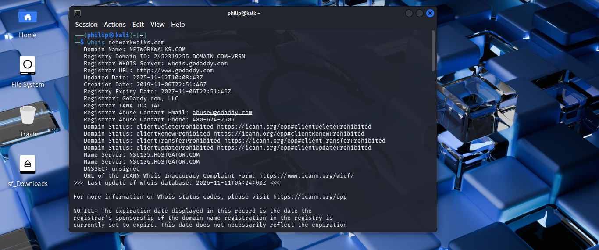

**Answer: GoDaddy registrar; created 2019-11-06; name servers on HostGator. In my saved full output the registrant details are hidden behind a privacy service (Domains By Proxy).**

## Step 2. whatweb (Task 2)
I fingerprinted the website's technologies.

```bash
whatweb networkwalks.com
```

`http://networkwalks.com` answered with a `301 Moved Permanently` redirect to HTTPS. The HTTPS page answered `200 OK` and WhatWeb reported Apache, WordPress 7.1.4, WordPress Download Manager 3.3.76, jQuery 3.7.1, Google Tag Manager, the IP `192.232.216.135` and a contact email address.

My first attempt had a typo in the domain. I describe it in the Challenges section; the screenshot below is the correct run.

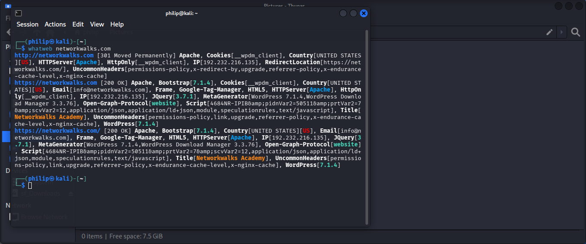

**Answer: Apache + WordPress 7.1.4 + WordPress Download Manager 3.3.76, server IP 192.232.216.135.**

## Step 3. nslookup (Task 3)
I resolved the domain name to its IP address.

```bash
nslookup networkwalks.com
```

My resolver was `8.8.8.8` and the answer was marked "Non-authoritative".

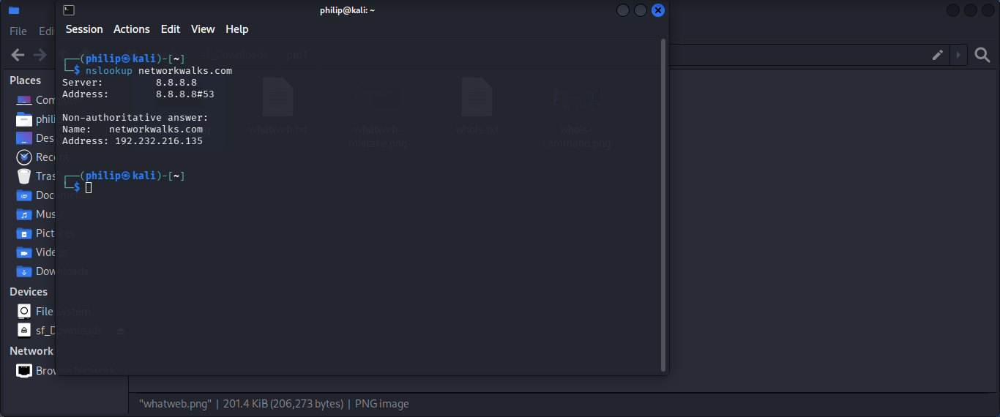

**Answer: 192.232.216.135.**

## Step 4. curl -I (Task 4)
I read only the HTTP response headers.

```bash
curl -I https://networkwalks.com
```

The response was `HTTP/2 200` with `server: Apache` and `x-nginx-cache: WordPress`. The `link` header exposes the WordPress REST API at `/wp-json/`. The site also set a `__wpdm_client` cookie with the `secure` and `HttpOnly` flags.

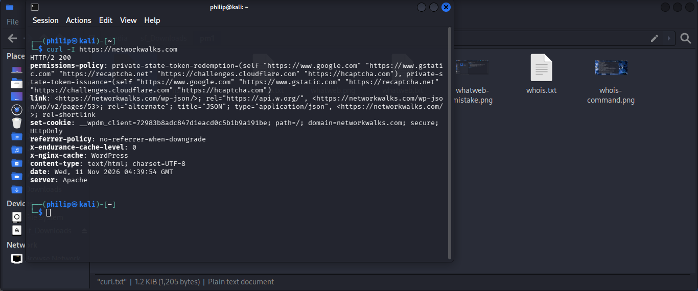

**Answer: HTTP/2 200, Apache server, WordPress REST API endpoint `/wp-json/` exposed in the headers.**

## Step 5. wafw00f (Task 5)
I checked whether a Web Application Firewall sits in front of the site.

```bash
wafw00f networkwalks.com
```

wafw00f v2.3.1 needed 2 requests and reported the site as being behind a WAF.

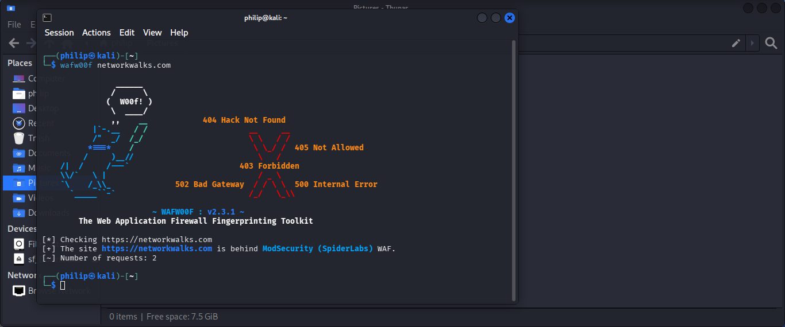

**Answer: ModSecurity (SpiderLabs) WAF.**

## Step 6. dnsrecon (Task 6)
I enumerated the domain's DNS records.

```bash
dnsrecon -d networkwalks.com
```

The screenshot shows the first part of the output (the window cut off the last two SRV lines). The saved text file has the complete output.

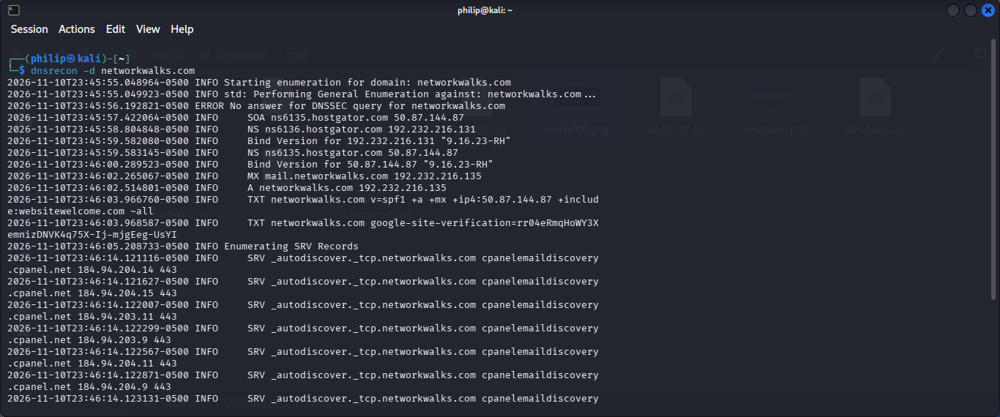

**Answer: SOA and NS on HostGator (`ns6135` / `ns6136`), BIND `9.16.23-RH` on both, MX `mail.networkwalks.com` at 192.232.216.135, an SPF TXT record, a Google site-verification TXT record and 8 cPanel autodiscover SRV records.**

---

# Part 2: W2-PM5 Network Scanning with Zenmap

## Step 7. Install Zenmap (Task 1)
The lab guide installs Zenmap on Windows with a setup file. I run Ubuntu, so I used the Zenmap Python wheel listed on the Nmap download page, with the Nmap package from `apt`. I used Gemini to help me work out the Ubuntu commands, and the screenshots below include those chat answers. The install did not go smoothly; the full story is in the Challenges section.

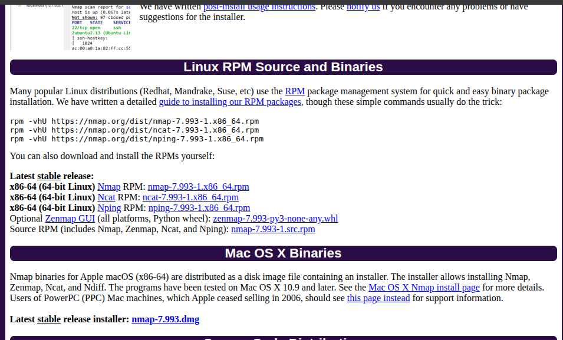

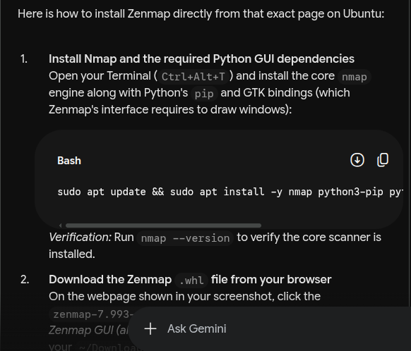

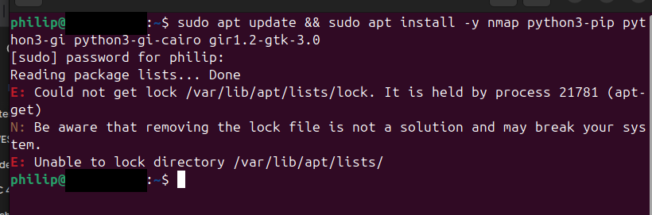

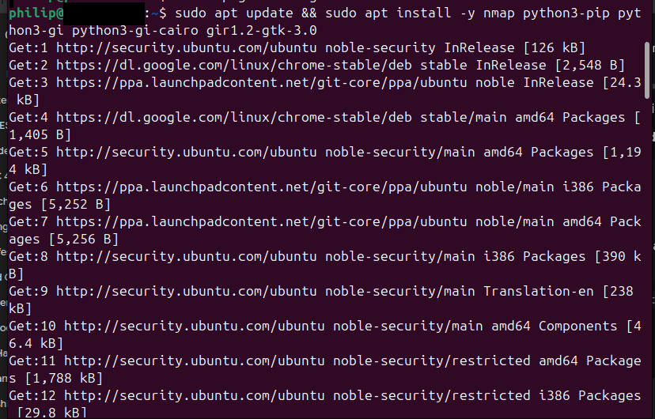

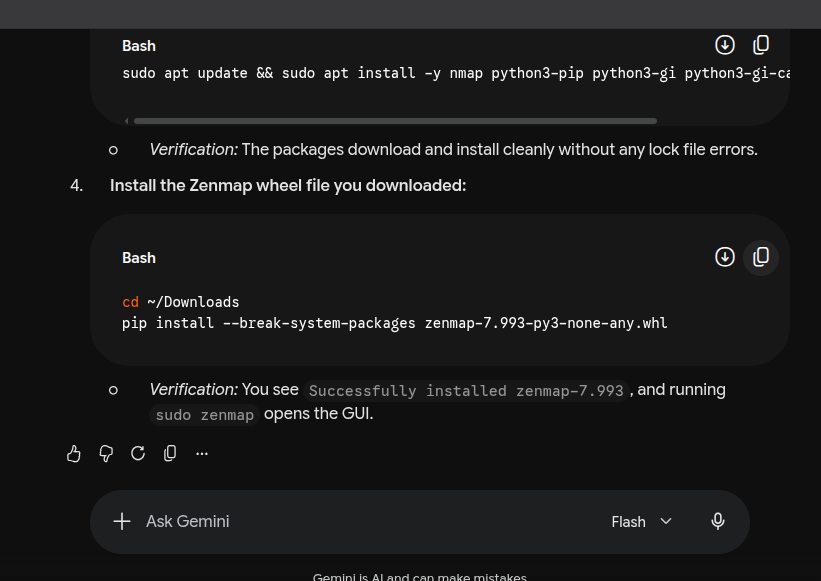

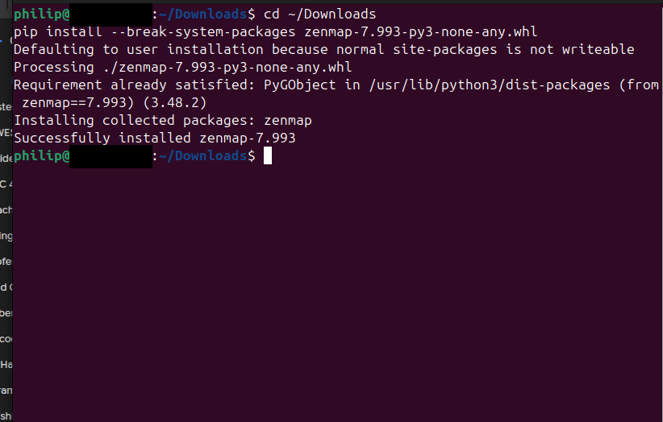


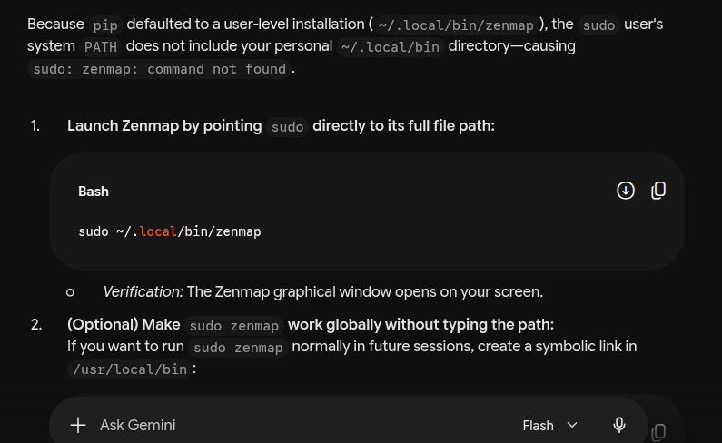

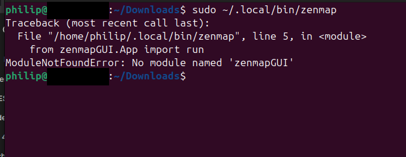

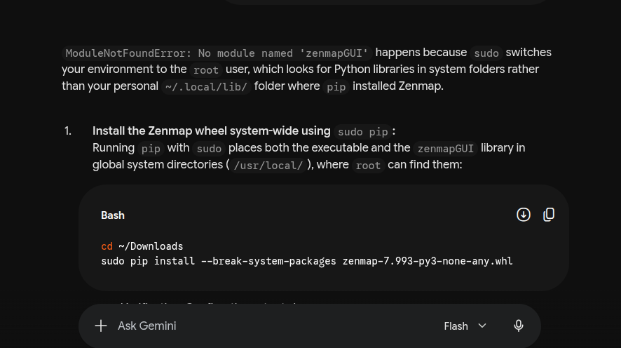

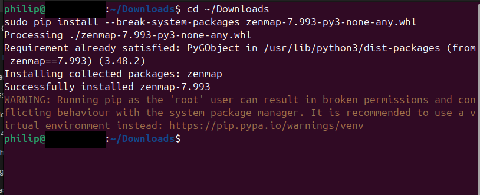

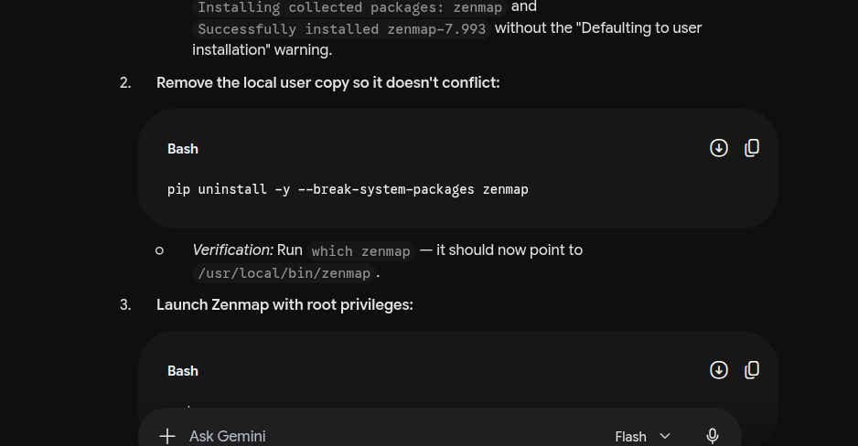

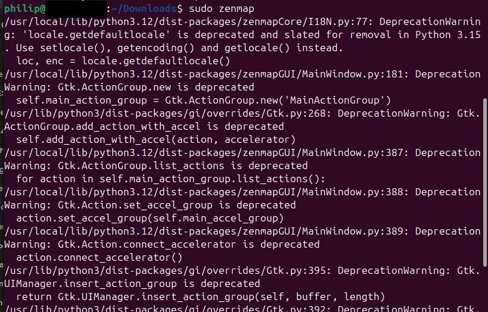

Zenmap finally opened with `sudo zenmap`. It starts with the default "Intense scan" profile selected.

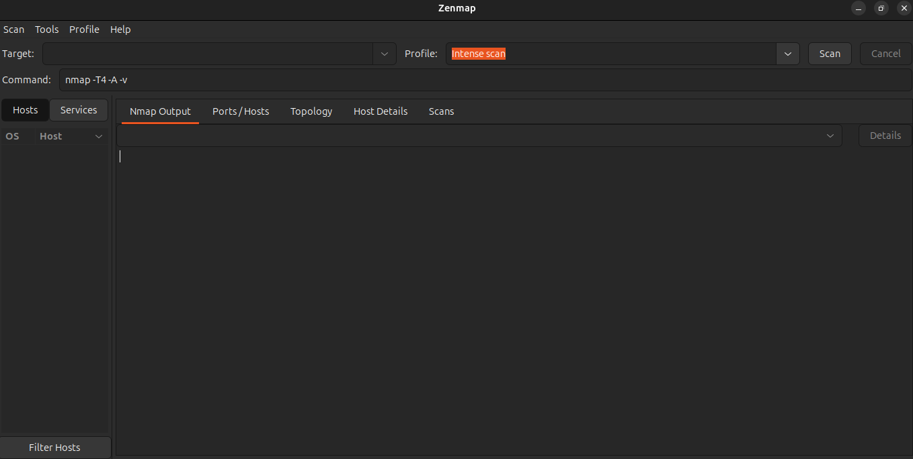

**Answer: Zenmap 7.993 installed and running (with Nmap 7.94SVN).**

## Step 8. Find my IP address and subnet (Task 2)
The guide uses `ipconfig` on Windows. On Ubuntu I used `ip`.

```bash
ip -4 addr show
ip route show
```

My Wi-Fi interface `wlp2s0` has the address `10.239.222.17/24` and the default route goes through `10.239.222.120`. The connected network is `10.239.222.0/24`.

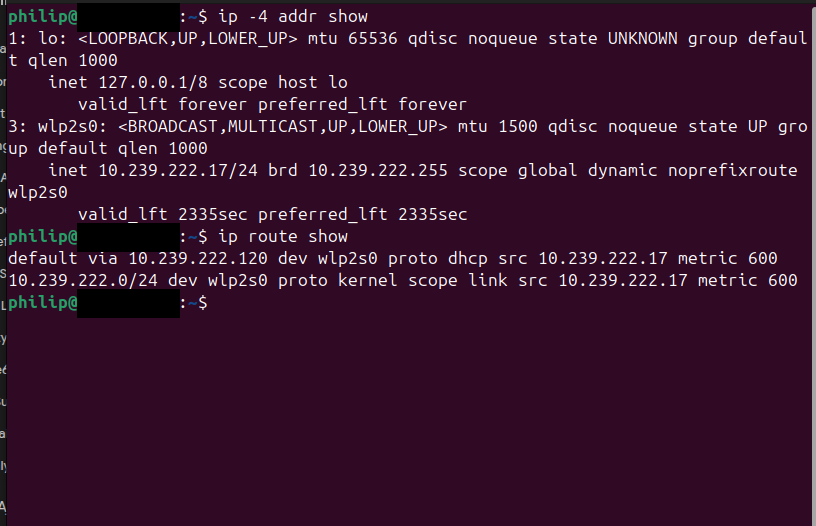

**Answer: IP 10.239.222.17, subnet 10.239.222.0/24, gateway 10.239.222.120.**

## Step 9. Ping scan: live hosts, IPs and MACs (Tasks 3 to 6)
In Zenmap I entered the subnet as the target, chose the **Ping scan** profile and clicked Scan. Zenmap ran this command:

```bash
nmap -sn 10.239.222.0/24
```

The scan started at 15:38 WAT on 12 November 2026 and finished in 7.97 seconds. It checked 256 addresses and found **2 hosts up**: the gateway `10.239.222.120` and my own machine `10.239.222.17`. Nmap printed a MAC address only for the gateway. The vendor lookup for it says "Unknown".

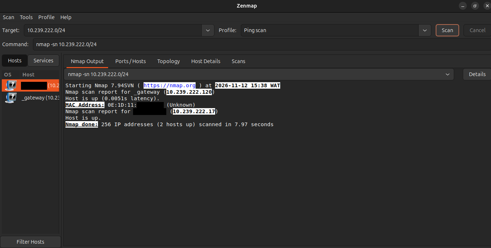

Nmap does not print a MAC for the machine it runs on, so I read my own MAC with `ip link show`. The interface that is `UP` is `wlp2s0` (the highlighted block), which is the one that holds `10.239.222.17`.

```bash
ip link show
```

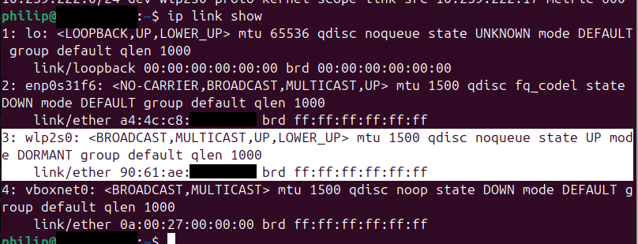

**Answers: 2 hosts live. IPs: 10.239.222.120 and 10.239.222.17. MACs: gateway `0E:1D:11:xx:xx:xx`, my machine `90:61:AE:xx:xx:xx` (last three bytes hidden for privacy).**

## Step 10. Topology (Task 7)
I opened the **Topology** tab, turned on the legend, and used **Save Graphic** to save the topology as a PDF (`topology.pdf`).

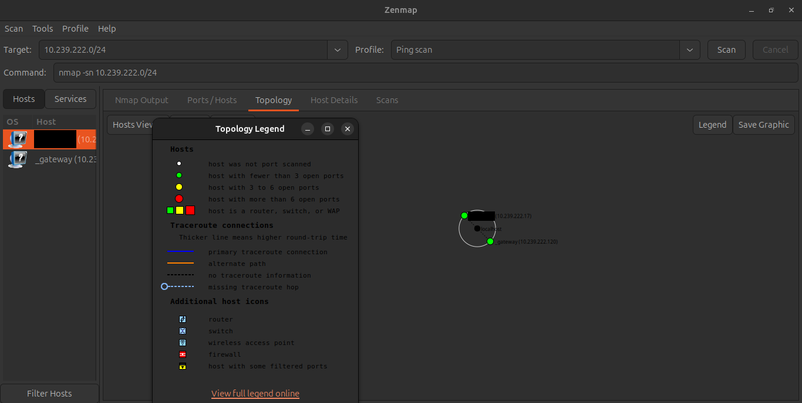

This is the saved graphic (my hostname is blacked out here too):

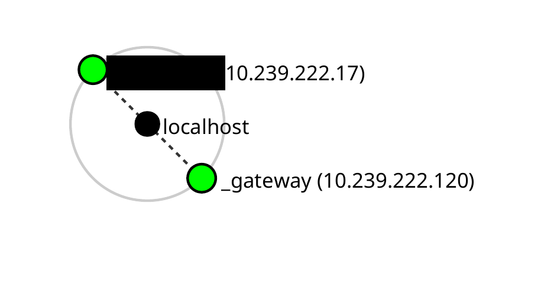

**Answer: topology saved as PDF. It shows `localhost` in the centre with my machine and the gateway around it.**

---

# 📊 Results

| # | 🎯 Task | ✅ Answer | 🔎 How I Found It |
| - | ------- | --------- | ------------------ |
| PM1-1 | Domain registration | GoDaddy; created 2019-11-06; HostGator name servers | `whois networkwalks.com` |
| PM1-2 | Web technologies | Apache, WordPress 7.1.4, WP Download Manager 3.3.76 | `whatweb networkwalks.com` |
| PM1-3 | Domain to IP | 192.232.216.135 | `nslookup networkwalks.com` |
| PM1-4 | HTTP headers | HTTP/2 200, Apache, `/wp-json/` exposed | `curl -I https://networkwalks.com` |
| PM1-5 | WAF | ModSecurity (SpiderLabs) | `wafw00f networkwalks.com` |
| PM1-6 | DNS records | NS, SOA, MX, SPF TXT, 8 SRV records | `dnsrecon -d networkwalks.com` |
| PM5-1 | Install Zenmap | Zenmap 7.993 running | apt + pip, see Challenges |
| PM5-2 | IP and subnet | 10.239.222.17 in 10.239.222.0/24 | `ip -4 addr show`, `ip route show` |
| PM5-3 | Live hosts | 2 hosts up | Zenmap ping scan (`nmap -sn`) |
| PM5-4 | How many live | 2 | Nmap summary line |
| PM5-5 | Live host IPs | 10.239.222.120, 10.239.222.17 | Nmap output |
| PM5-6 | Live host MACs | Gateway `0E:1D:11:xx:xx:xx`; mine `90:61:AE:xx:xx:xx` | Nmap output and `ip link show` |
| PM5-7 | Topology as PDF | Saved as `topology.pdf` | Topology tab, Save Graphic |

*Footnote: PM5 Task 3 and 4 share one screenshot with Task 5 because one Nmap output answers all three. For PM1 Task 1 the screenshot shows only the top of the `whois` output; the rest is in my saved text file. The PM1 Task 6 screenshot is cut off after six SRV records; the saved text file lists all 8.*

### Timeline of the PM1 session (from my screenshots and saved output, Kali VM clock)
| ⏱️ Time | 🛠️ Tool | 🔄 What happened |
| ------- | ------- | ---------------- |
| 23:24 | whois | Registration record collected |
| 23:30 | whatweb | Typo in the domain, interrupted with Ctrl+C |
| 23:34 | whatweb | Correct run completed |
| 23:37 | nslookup | Resolved to 192.232.216.135 |
| 23:41 | curl -I | Headers read |
| 23:44 | wafw00f | ModSecurity detected |
| 23:45 to 23:46 | dnsrecon | DNS records enumerated |

---

# 🔭 Observations Beyond the Task Questions

These are things I noticed in my screenshots and saved output while documenting. The labs do not ask for them.

1. **My results differ from the lab guide's examples.** The guide shows WordPress 7.0.4 and Download Manager 3.3.58; my run shows 7.1.4 and 3.3.76. The guide shows wafw00f v2.4.2; I had v2.3.1. Software versions change over time, so a fingerprint is only a snapshot.
2. **The website and the mail server share one IP.** `dnsrecon` shows the A record and the MX host `mail.networkwalks.com` both at `192.232.216.135`.
3. **The SPF record ends with `~all`.** That is a "soft fail" policy. I did not test email spoofing, so I cannot say what effect it has in practice.
4. **The DNS software version is visible.** `dnsrecon` reported BIND `9.16.23-RH` for both name servers.
5. **DNSSEC is not signed.** `whois` says `unsigned` and `dnsrecon` logged "No answer for DNSSEC query".
6. **The registry and registrar records in my saved `whois` output list different name servers.** The registry part lists two HostGator servers; the registrar part also lists two `DOMAINCONTROL.COM` servers. `dnsrecon` only showed the HostGator ones, so I cannot tell which set is actively serving the zone.
7. **The SRV lookups were the slowest part of `dnsrecon`.** The log timestamps go from 23:46:05 to 23:46:14 for them, about 9 seconds of the roughly 19 second run.
8. **Zenmap's topology colours puzzled me.** The legend says white means "not port scanned", but my two nodes are green. A ping scan does not scan ports, so I cannot tell from the capture why they are green.
9. **The gateway's MAC starts with `0E`.** The vendor lookup returned "Unknown", so I cannot tell what device it is from Nmap alone.
10. **My Zenmap run found only 2 hosts and the guide example found 4.** The scan also finished in 7.97 seconds against 2.82 seconds in the guide. Different networks, so no conclusion from that.

---

# 🐞 Challenges Encountered

* **Issue (PM1 Task 2):** I typed `whatweb networks.com` instead of `networkwalks.com`. I interrupted it with Ctrl+C, and the Ruby stack trace shows it was stopped inside WhatWeb's check that the site is alive. The domain `networks.com` is **not** in my authorized scope. No scan results were printed, and I cannot tell from the capture whether any network request reached that domain.
  **Resolution:** I re-ran the command with the correct domain, `networkwalks.com` (the correct run is the screenshot in Step 2). I am keeping the evidence here for transparency.
  **What I'll do differently:** Copy the target from the authorization letter instead of typing it, and read the command back before pressing Enter.

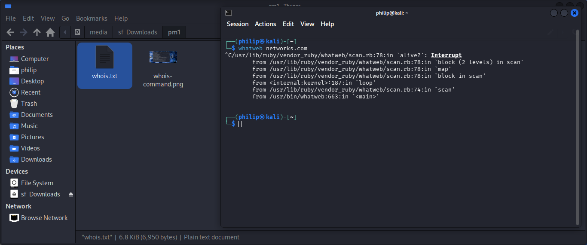

* **Issue (PM5 Task 1, apt lock):** The first `apt` command failed with "Could not get lock /var/lib/apt/lists/lock. It is held by process 21781 (apt-get)".
  **Research:** I asked Gemini for the Ubuntu install steps (screenshots 2 and 5) and re-ran the command (screenshot 4 shows the package lists downloading). My captures do not show the end of that install.
  **What I'll do differently:** Check what is holding the lock before retrying, and do not try to delete the lock file; apt itself warns that this can break the system.

* **Issue (PM5 Task 1, Zenmap would not start):** `pip` installed Zenmap in my user folder because the system folders were not writable. `sudo zenmap` then said "command not found", and `sudo ~/.local/bin/zenmap` failed with `ModuleNotFoundError: No module named 'zenmapGUI'`.
  **Research:** Gemini explained that `sudo` switches to root, which looks in different paths than my user account (screenshots 8 and 10).
  **Resolution:** I installed the wheel again with `sudo pip install --break-system-packages`, which worked but printed a warning that running pip as root can cause broken permissions (screenshot 11). `sudo zenmap` then opened the GUI with some harmless deprecation warnings. Gemini also suggested removing the user-level copy (screenshot 12); my captures do not show whether I ran that step, so I am not claiming it.
  **What I'll do differently:** Use a virtual environment or `pipx` for Python tools instead of `--break-system-packages` and root pip.

* **No other blockers.** All six PM1 tools and the PM5 scan ran as the lab describes.

---

# 💡 Key Learnings

1. Footprinting reads only public information, yet in a few minutes it gave me the registrar, hosting provider, web stack with versions, WAF and mail setup of a real site.
2. Each tool answers a different question: `whois` (who and when), `nslookup`/`dnsrecon` (where and which records), `whatweb`/`curl` (what software), `wafw00f` (what protects it).
3. Exposed versions are only a starting point. I did not test any vulnerability, so none of my findings is a confirmed weakness.
4. A guide's example output is only a sample. My versions and results were different, so I report what I actually saw.
5. A ping scan tells you which hosts are alive, and on my own LAN it also showed the gateway's MAC. It does not scan ports.
6. Typing a target by hand is risky. A one-word typo pointed a tool at a domain I had no permission to test, so I will copy targets from the authorization letter.
7. Package tools behave differently under `sudo` because root has different paths. I should have read the error before trying fixes.
8. Writing the documentation made me notice details (shared IP, SPF policy, the unsigned DNSSEC) that I missed while running the commands.

---

# 🔐 Security & Ethical Use

This work is for education only. I only tested `networkwalks.com`, which Networkwalks authorized in writing, and my own network. The authorization covers reconnaissance and scanning only, and I did not attempt exploitation, brute force or any access to data. Do not run these tools against systems you do not own or do not have written permission to test; unauthorised access is a crime in most countries even when nothing is damaged.

---

# 🔗 Tools & Resources

- **Nmap / Zenmap download:** https://nmap.org/download.html
- **WhatWeb, wafw00f, dnsrecon, whois, curl, nslookup:** tools included in Kali Linux
- **NetworkWalks:** https://networkwalks.com

---

# 👤 Author
**Philip Ajik**
Cybersecurity Student (Batch B082) — Networkwalks Academy
LinkedIn: https://www.linkedin.com/in/philip-ajik-a22944384

---

## 📌 Project Information
**Program Name:** Cybersecurity at Networkwalks | **Task:** W2-PM1 and W2-PM5 | **Project:** Footprinting with Kali Tools and Network Scanning with Zenmap | **Repository:** GitHub
